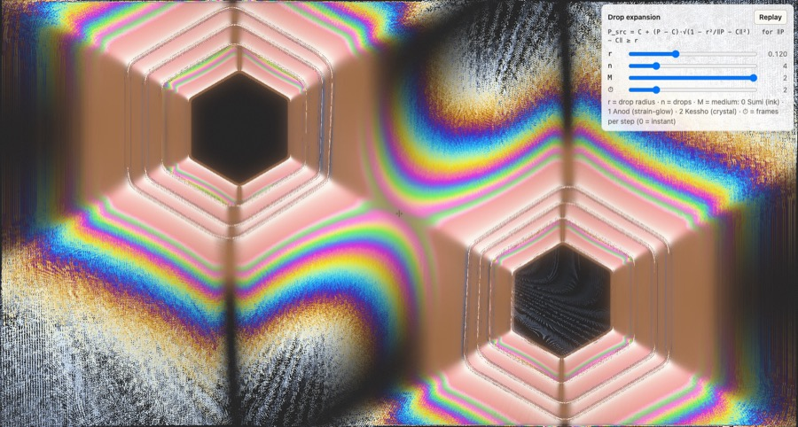
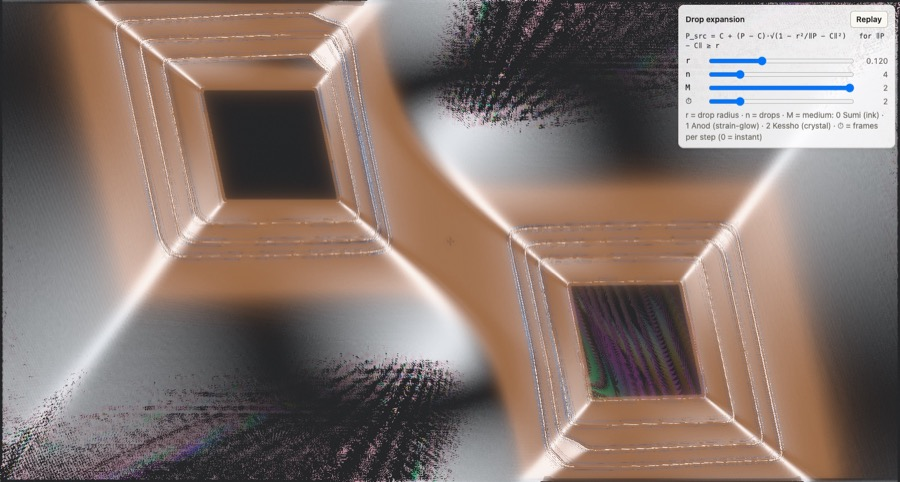
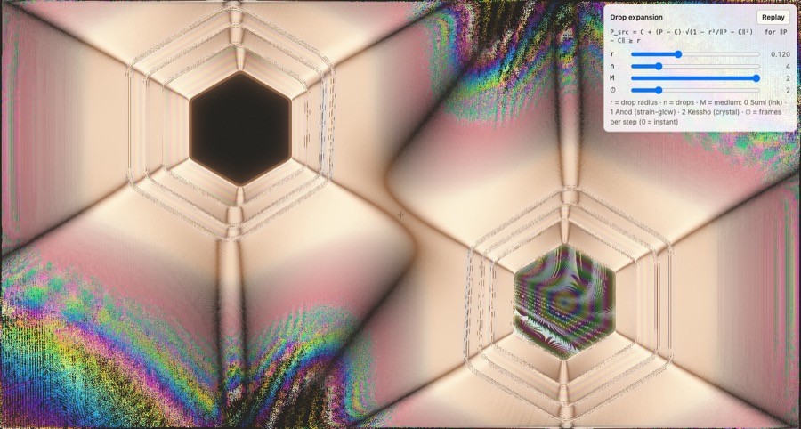
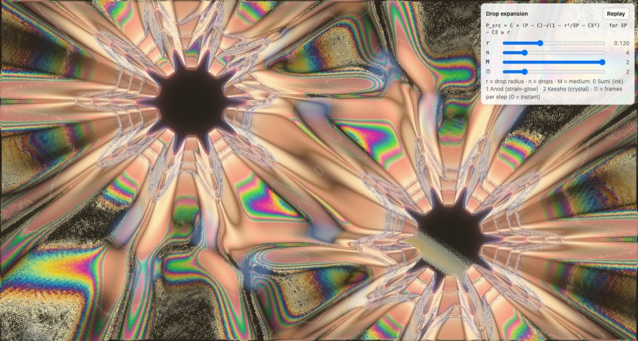
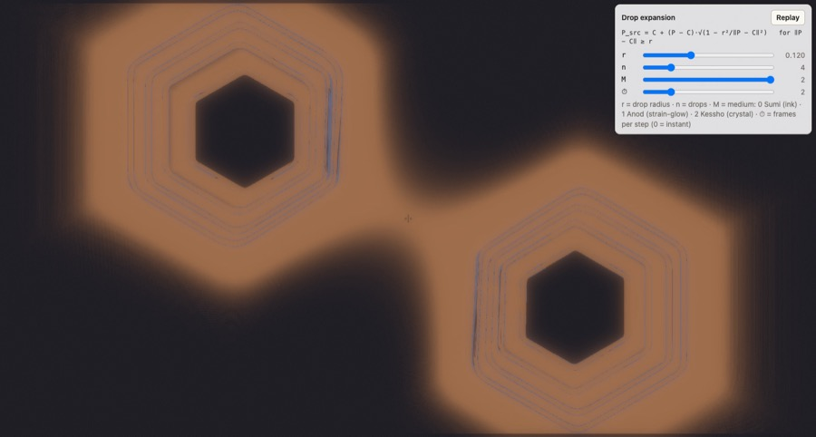
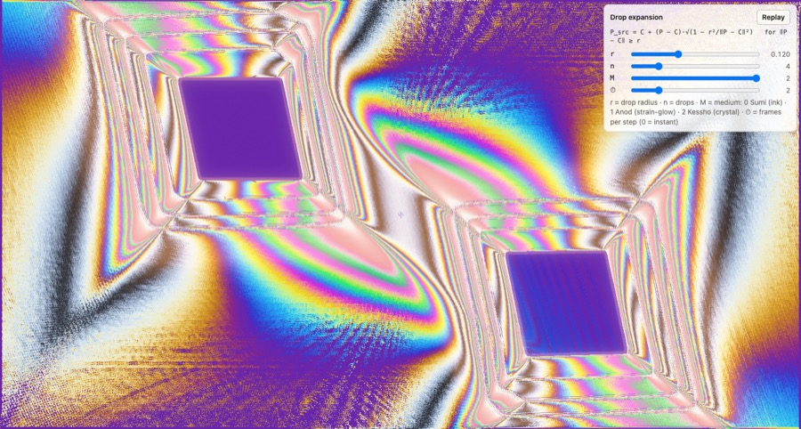

import Operator from "../../../components/Operator.astro";

**Lineage.** The tine and the drop are Professor Jaffer's: a shear by a
function of one coordinate, an expansion that conserves area. The crystal
drop is William Rowan Hamilton's (1832): the action-angle coordinates in
which that expansion becomes a translation, and the kick generated by a
function of the angle alone — the first use, in his own work on conical
refraction in biaxial crystals, of what became symplectic geometry. The
medium that reads the result between crossed polarizers takes its laws from
Michel-Lévy's chart, Frocht's photoelasticity and Baumhauer's twin lamellae.

Where Sumi and Anod bring palettes, **Kessho brings minerals** (v3.0,
libsumi 1.7.0). A free gradient fights a medium whose colours are a law —
the Michel-Lévy chart by retardation — so the Kessho palette library of the
first landing is retired and a mineral takes its place: one table, the
physical chart, and a descriptor that says how *this* crystal reads the
field. A mineral has two halves in two shaders, independent as parameters
and paired by the presets the way nature pairs them.

## The optical half — `sumi_mineral_t`

The composite is a pure reader: switching minerals leaves the field bitwise
(the medium-switching gate extends to every mineral). Since 3.0 Layer A reads
its strain through the *strain buffer* — $\sigma$ averaged over the afterglow's
seconds (*Spark afterglow*, shared with [Anod's spark reading](../anod/)) —
so the fringes build and settle over a fraction of a second instead of
snapping; a side buffer, the field still bitwise. The descriptor is a
sized struct the editor edits and the presets fill:

| Field | What it is |
|---|---|
| `optic_class` | **Isotropic**: no birefringence, Layer A dark — the fold and the regime tints alone. **Uniaxial**: the brush $\sin^2 2(\psi - \alpha)$, the Maltese cross. **Biaxial**: the cross splits into two brushes $2V$ apart, $\lvert\cos^2 2V - \cos^2 2(\psi - \alpha)\rvert / \max(\cos^2 2V, \sin^2 2V)$ — the isogyres of a biaxial figure separating; a stylisation of the conoscopic figure (that law lives in angle space, which a texel does not have), kept at the analyzer's $\pi/2$ period. |
| `retardation` | $\Gamma$, nm of retardation at unit strain: the birefringence $\Delta n$ under one common exposure, $2000 / 0.009$ nm per unit $\Delta n$, so quartz lands where the medium was first captured. The *Exposure* knob scales it (2000 = one stop). Beyond the chart's 2200 nm the orders wash to high-order white — thick spar sits there by physics. |
| `retardation_bias` | $\Gamma_0$, the **sensitive-tint plate** — a full-wave plate fixed to the sheet at 45°: the resting field is first-order magenta at 550 nm and a shear's sign shows as blue or yellow, $\Gamma_{\text{eff}} = \lvert\Gamma_0 + \Gamma\sigma\sin 2\psi\rvert$. The plate floods the cross (no brush), and the analyzer's turn plays no part. |
| `walkoff` | $\delta$, the **double image** of calcite: the chart read again at $\pm w$ along the strain's axis, $w = \delta\,\sigma\,\lvert\sin 2(\psi - \alpha)\rvert\,\hat e_\psi$ texels, under the point's own brush — on the dark arms the split is closed (the isogyres stay sharp), where the sheet rests there is nothing to double; the caustic is not doubled. |
| `dispersion` | $(z_B / z_R) - 1$: **three caustic depths**, red shallow and blue deep about the geometric mean — three offset iso-trace folds, a rainbow on the fold. |
| `conical_ring` | **Hamilton's ring**: near the parabolic line ($\lvert\Delta\rvert$ small) where the sheet strains, the fold's light is read through a ring kernel of eight points at this radius — the hollow cone of conical refraction, a line on the fold doubling into two. Masked tight; the one moderately expensive law. |
| `film_n`, `film_r` | the **thin film** of mica: the ink read as a sheet of thickness $h$ (from the band's radial fraction, 200–800 nm), Airy's $R(\Lambda) = 4r^2\sin^2(\delta/2) / ((1 - r^2)^2 + 4r^2\sin^2(\delta/2))$ with $\delta = 4\pi n h\cos\theta_s / \Lambda$ at 610, 550 and 465 nm, $\cos\theta_s$ the sheet's tilt from $\sigma$. |
| `body_tint` | the backlight through the crystal's body: the substrate's tone (faint, frosted, screen-locked), the fringes' and the caustic's cast. |
| `bloom_gain` | Layer B only — the fold and the regimes bloom, the fringes never. |
| `lut_id` | 0 the physical Michel-Lévy chart; 1 the custom palette slot read once per order — the one stylised chart a user can still shape. |

## The mechanical half — the habit and the cleavage

How the crystal *admits* a strike and a stroke lives in the deformation
shaders and changes the field, so it carries the conservation gates of the
exact class. The **crystal drop** is [the drop page's](../drop/) theorem:
$\rho_{src} = \rho - R(\theta)^2/2$ in the action-angle frame, $\det J = 1$
for any habit $R(\theta) > 0$ at any amplitude — the proof is one line: in $(\rho, \theta)$ the area form is $d\rho \wedge d\theta$, and a translation of $\rho$ by a function of $\theta$ alone has the Jacobian $\bigl(\begin{smallmatrix} 1 & -R R' \\ 0 & 1 \end{smallmatrix}\bigr)$, a shear, $\det = 1$ — the rings inside homothetic
copies of the habit, growth the same map, the corners creasing where $R'$
jumps. The **cleavage profiles** are [the tine page's](../tine/): a shear by
any function of the perpendicular distance is exact; the twin kink and the
terrace are bumps, zero beyond $H = 4\alpha$. Both halves are params
(`drop_habit`, `habit_roundness`, `habit_blades`, `tine_profile`), read at
strike and stroke time; habit 0 and profile 0 are bitwise the first
release's drop and tine.

## The six at ship

| Mineral | Optic | $\Delta n$ | Laws on | Habit | Tine | Body |
|---|---|---|---|---|---|---|
| Quartz | uniaxial | 0.009 (the reference: the medium as first captured) | — | hexagon (the prism's section) | smooth | clear |
| Calcite | uniaxial | 0.172 | walk-off | rhomb (the cleavage rhombohedron) | twin kink | cold white |
| Muscovite | biaxial, $2V = 40°$ | 0.040 | thin film | hexagon (the pseudo-hexagonal plate) | terrace | champagne |
| Barite | biaxial, $2V = 37°$ | 0.012 | dispersion, conical ring | rosette, $m = 5$ (the desert rose) | smooth | honey |
| Fluorite | isotropic | 0 | — | hexagon (the cube along its body diagonal) | smooth | violet |
| Selenite | uniaxial | 0.010 | $\Gamma_0 = 550$ nm | rhomb (gypsum's cleavage plate) | smooth | clear |

The six as the web build draws them — the drop scene under Kessho, four
drops, the mineral by `mineral=0…5` on the scene's address (captured for
the 3.0 release; the marble's live scene is the newest stable tag's):

| | | |
|---|---|---|
|  |  |  |
| Quartz | Calcite | Muscovite |
|  |  |  |
| Barite | Fluorite | Selenite |

Every habit ships at roundness 0 — the sharp polygon, the corners creasing —
the author's call for this phase, to be reviewed at its end with the new
operators; a square (the face-on cube) is not a habit yet.

The ratios between the retardations are physical; the exposure that maps
them onto the chart is the one number set by eye. The presets live in the
settings window's *Mineral* section and as `presets/kessho_<mineral>.json`,
each carrying both halves; the bench's `--mineral <id>` runs under one. The
Suzu conical intersection — the double cone in the trace — is deferred to
the synth's own phase.

## A reader's exercise — the selenite sign test

Selenite is the petrographer's **sensitive-tint plate**: its $\Gamma_0 = 550$ nm
puts the unstrained sheet at the first-order red, the steepest point of the
Michel-Lévy chart, and the layer reads
$\Gamma_{\text{eff}} = \lvert \Gamma_0 + \Gamma\sigma \sin 2\psi \rvert$. A
strain whose principal stretch lies along the plate's slow axis *adds* to
$\Gamma_0$ and the tint climbs to the second-order blue; across it the strain
*subtracts* and the tint falls to the first-order yellow. The sign of the
strain against the analyzer is read as a colour — which is what the plate is
for.

1. Strike one drop under Selenite. The drop's strain is radial — its
   principal stretch is tangential, and $\psi$ turns once around the ring —
   so $\sin 2\psi$ changes sign four times on the way round. Before looking,
   predict from $\Gamma_{\text{eff}}$ which two quadrants go blue and which two
   yellow for the analyzer at its default angle. Then look.
2. Turn the polarizer by a quarter turn (the slide under Kessho's default
   table, or a CC on the polarizer's angle, dimension 20): the quadrants
   swap. Half a turn: they are back. The brush has period $\pi/2$, and so does
   the sign.
3. Draw a tine stroke. A shear's principal directions sit at $45°$ to the
   stroke, so the lobes of blue and yellow lie along its diagonals rather than
   its axes — the drop's quadrants, turned by an eighth of a turn. Say why,
   from $\psi$ alone, before the water does.
4. Switch the mineral to Quartz with the same strokes: no bias, no sign — the
   same strain reads as the same colour whichever way it points. The sign test
   is Selenite's alone.

<Operator scene="drop" params={{ n: 4, r: 0.1, medium: 2, mineral: 5 }} caption="Live, under Kessho with Selenite: four drops — the quadrants of blue and yellow around each, swapping with the analyzer's angle. ◇ is not a slider here: `mineral=5` on the address picks the plate; 1 is Calcite's rhomb with its walk-off, 3 Barite's rosette and its conical ring." />
