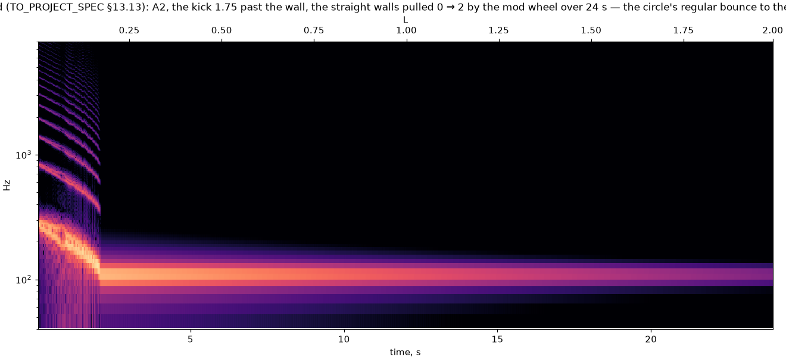
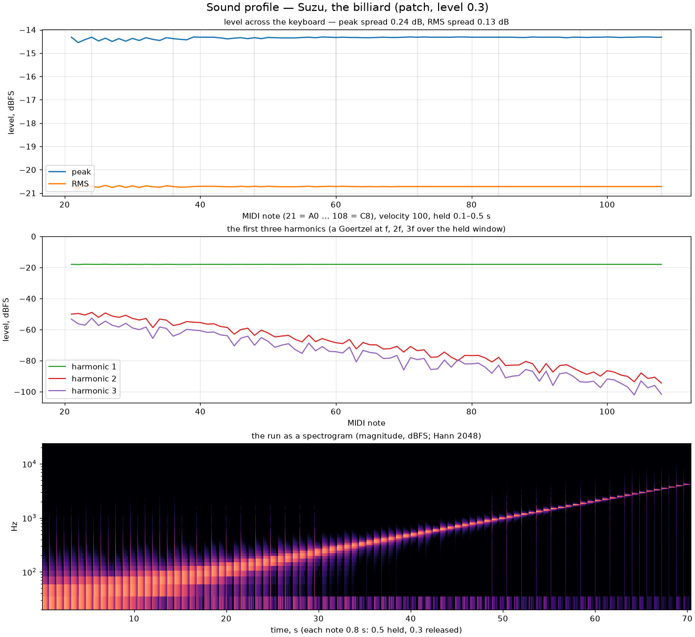

import Lab from "../../../components/Lab.astro";

## The flight and the wall

The state is a position $(x_1, x_2)$ in the wall's units and a velocity
$(y_1, y_2)$ in the cell's, and between the walls the particle is the note's
oscillator in two dimensions: each plane turns by $\theta = \omega_0\,dt$ a
step, the exact rotation as three shears, at four times the output rate. The
wall is a stadium — two half-ellipses, their aspect on CC 74, joined by
straight walls whose length the mod wheel sets. A step that would cross the
wall is cut at the crossing: the fraction of the rotation found by sixteen
bisections on the angle, the velocity reflected off the wall's normal,
$v' = v - 2(v\cdot\hat n)\hat n$, the rest of the rotation taken. Rotations
and reflections: the map has $\det J = +1$ on the four-dimensional state,
Liouville's theorem, and the suite reads the energy across sixty-six thousand
collisions in a lossless minute at $2\cdot10^{-12}$ dB. (The proposal's
$\det J = -1$ was the two-dimensional impact oscillator's, a different voice.)

## The fold

The kick is the drive times the velocity gain, in units of the wall, along
the cell's position by the equal-power pan law — at the centre a radial
orbit on the circle, both channels the same bits. Under one wall-width the
voice is a sine at the note; past it the orbit folds, and the fold raises the
pitch: a radial orbit kicked $v$ past the wall bounces at

$$
\frac{\pi/2}{\arcsin(1/v)}
$$

times the note — 2.58× at $v = 1.75$, measured within a hundredth of a
percent — as a ball bounces faster in a bowl with walls, and the note returns
as the orbit decays under the wall. The default drive puts the wall at
mezzo-forte with the fold above it. The circle's orbits are integrable, the
wavefolder's harmonics; pull the walls out with the wheel and the stadium's
orbits are ergodic — the grit, with left and right no longer the same.

## The kink

A reflection jumps the velocity, so the positions carry a slope
discontinuity that sampling at 192 kHz would alias. Each collision adds the
two-point polyBLAMP residual of its slope jump at its fraction of the step —
$\Delta(1-f)^3/6$ to the sample before, $\Delta f^3/6$ to the sample after —
through a one-sample output delay. The off-grid residual of the circle's
periodic orbit in the top octave is −80.5 dB of the fundamental over
A3..A5, against the roadmap's −60. The lab's red is the reflection at the
step's end: it does not alias — a sample-periodic orbit aliases onto its own
grid — but the bounce is quantised to whole steps, 3.8 % off the geometry
where the exact path is within a hundredth of a percent.

<Lab page="billiard" caption="The billiard, live: the table — the two half-ellipses and the straight walls — with the orbit inside it, the strobe's returns (a line on the circle, dust on the stadium) and the bounce measured against (π/2)/asin(1/v) from the engine's own H. The wheel pulls the walls out; the red control reflects at the step's end." />

## The strobe

At the bass the circle's radial orbit returns to a line — twenty-four of a
576-cell grid along the diagonal; a kick from the centre has no angular
momentum, so the circle's section is a segment, not the roadmap's ring, which
wants a strike away from the centre — and the stadium's to dust, 153 cells,
the ergodic section.
The bench's `--voxo-chart` writes the sweep, the wheel pulling the walls from
the circle to the stadium over twenty-four seconds:

## The profile

*Billiard (stadium)* is the twenty-first patch of the [table](../patches/),
a little stadium at rest and the wheel to the full one; the desktop's Sound
section carries the drive, the aspect, the two lengths, the decay and the
pluck as the kick's pan; a preset file carries the four fields.
