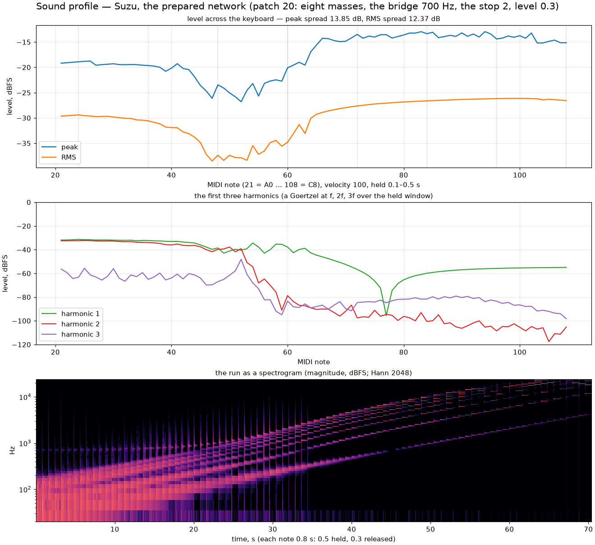

## The structure

Write any lossless network of springs, masses and their couplings as

$$
\dot{x} = (J - R)\,\nabla H(x), \qquad H = \tfrac12 x^{\mathsf T} Q x,
$$

with $Q$ the energy's weights (the springs' stiffnesses, the masses' inverse
masses), $J = -J^{\mathsf T}$ the *Dirac structure* that says which port's
effort drives which flow, and $R \succeq 0$ the dissipation. That is the
port-Hamiltonian form, and it composes: two networks joined at a port are a
larger $J$. Suzu's network keeps $Q$ diagonal by choosing its states well —
the springs' *extensions* and the masses' momenta rather than positions — so
that $J$ is the chain's incidence matrix and nothing more.

The step is the Cayley transform, the implicit midpoint rule in closed form:

$$
M = \left(I - \tfrac{h}{2}A\right)^{-1}\left(I + \tfrac{h}{2}A\right),
\qquad A = (J - R)\,Q,
$$

built once at the strike by Gauss–Jordan and applied as one dense product a
sub-step. With $R = 0$ the step is *Q-orthogonal* — an isometry in the energy
norm, $x^{\mathsf T}Qx$ conserved exactly — and not orthogonal, as the
roadmap's gate delta says; with $R \succeq 0$ it is strictly passive. The
suite does not take that on faith: at every build the engine reads the step's
gain in the energy norm, the largest singular value of
$Q^{1/2} M Q^{-1/2}$ by power iteration, and reports it in the inspection.
Over twelve random skew $J$ of six to sixteen states, at a step fifty times
the engine's, the gain is one to $2\cdot10^{-16}$ lossless and under one
damped. The state and $M$ are double: a matrix that is Q-orthogonal to
float's last place is a gain or a loss of that every step.

## The prepared network

The patch routes energy between four things, as the proposal asked. A chain
of masses on springs with both ends held — its lowest mode put on the note
with the bridge's loading counted, by inverse iteration on the
chain-and-bridge stiffness inside a secant on the spring, the target
prewarped for the midpoint rule: −0.2 cents at A3. A *bridge* mass on the
chain's last spring, with its own spring to the wall and its own loss — the
radiation; the voice is the force the string puts on it, a saddle pickup.
The bridge sits in the playing range by default, a body whose mode dips
the plucked keyboard ten decibels where the string's partials meet it; raise
it above the range and the keyboard flattens but the bow stops singing — the
bow is this patch's voice, so the body stays. The *stick-slip bow* of the strings' chapter on one of the masses, as
a port: between Cayley steps the bow's force is a kick on that mass's
momentum, solved against the friction curve with the bound, and its work goes
in the ledger — at the network's own scale, since the chain's force threw the
mass to the bow's speed every sub-step. And the *rattle stop*: a wall a short
way under the bridge's rest, in units of the pluck's static deflection; when
the bridge reaches it the bridge is held there and its momentum reflected
with the declared loss, as the reed hits its lay. Under the bow the bridge
rattles on it hundreds of times a second — the preparation.

The ledger is the point. Lossless, after four seconds under the bow with
the stop engaged 632 times, the energy held plus the stop's losses minus the
bow's gain equals the strike's energy to a millionth; the gain — the force
at the synchronised velocity — never exceeds the bow's work at its own speed,
the difference being the friction's heat. No feedback runaway, by arithmetic
rather than by a limiter.

## The level

The chain's impedance rises with the note, so a flat kick would tilt the
keyboard six decibels an octave; the pluck's kick and the bow's reference
scale with the note instead, and the plucked profile reads fourteen decibels
of spread over seven octaves, the body's dip, down from thirty-nine.

## What it costs

Eight masses are nineteen states: a 19 × 19 double product a sub-step,
0.8 % of a core a voice. The build at the strike is a 19 × 38 elimination and
sixty tridiagonal solves — nothing.

## The profile

*Prepared network* is the twentieth patch of the [table](../patches/); the
desktop's Sound section carries the masses, the bridge, its decay, the stop and
the bow's rows; a preset file carries the six fields.
