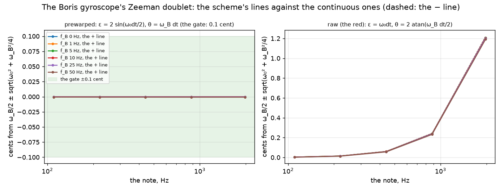
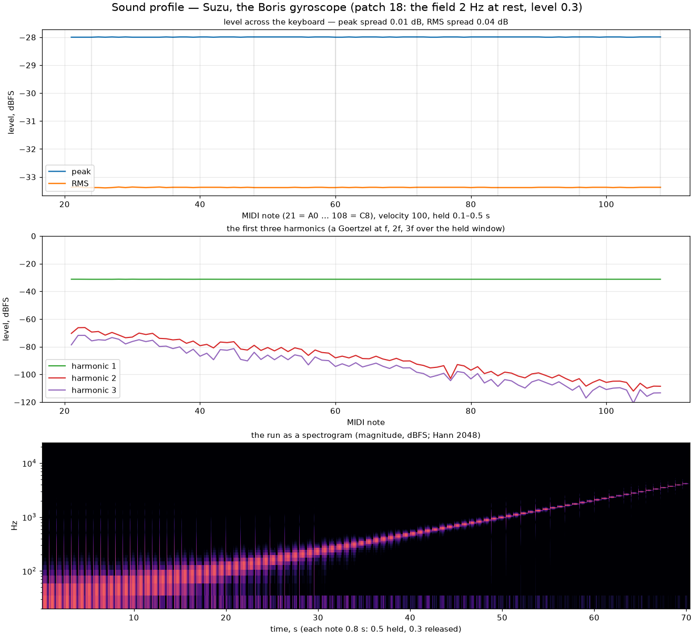

## The particle and the field

Put a charged particle on the note's spring in two dimensions — positions
$(x_1, x_2)$, velocities $(y_1, y_2)$ in the cell's units, so that a free
orbit is a circle — and switch on a magnetic field perpendicular to the
plane. The spring pulls the particle back; the field bends its velocity
sideways and does no work, because the Lorentz force is always at right
angles to the motion. The energy

$$
H = \tfrac12\left(x_1^2 + x_2^2 + y_1^2 + y_2^2\right)
$$

is the spring's alone, and the field only turns it round.

The step is the Boris leapfrog, the particle-pusher of plasma physics: half
a kick from the spring, $y \mathrel{-}= \tfrac{\varepsilon}{2}\,x$; the exact
rotation of $y$ by the field's angle $\theta_B$; the other half kick; then
the drift $x \mathrel{+}= \varepsilon\,y$. Every factor is a shear or a
rotation, so the map preserves phase-space volume exactly — $\det J = 1$ —
and, as the roadmap foresaw, it is *not* energy-exact once the spring's kick
is split round the rotation: the energy breathes with the splitting, by a
few hundredths of a decibel, and does not drift.

The rotation deserves a word. Written as a cosine–sine matrix it would be
exact in arithmetic and wrong in floating point: a matrix whose
$c^2 + s^2$ misses one by a unit in the last place scales the energy by
that amount every sub-step — $e^{\pm 1.7}$ over ten minutes at 96 kHz, a
drift no bounded-energy gate survives. Suzu writes it as three shears,
$t = \tan(\theta/2)$, then $s = \sin\theta$, then $t$ again, which is
exactly $\begin{pmatrix} \cos\theta & -\sin\theta \\ \sin\theta & \cos\theta \end{pmatrix}$
and, like every other shear in the engine, rounds as a walk rather than a
bias. The state is double, as the Toda ring's is.

## The Zeeman doublet

In a field the degenerate two-dimensional oscillator splits into two circular
modes, one turning with the field and one against it:

$$
\omega_\pm = \sqrt{\omega_0^2 + \left(\tfrac{\omega_B}{2}\right)^2} \pm \tfrac{\omega_B}{2},
$$

two lines $\omega_B$ apart — the Zeeman effect, with the note for the atom.
The scheme sounds them exactly when both the spring and the field are
prewarped: $\varepsilon = 2\sin(\omega_0\,dt/2)$ (the magic circle's) and
$\theta_B = \omega_B\,dt$ (the Boris angle $2\arctan(B_{\mathrm{num}}dt/2)$
with $B_{\mathrm{num}} = (2/dt)\tan(\omega_B dt/2)$). On
$z = x_1 + i x_2$ and $w = y_1 + i y_2$ the step is a complex-linear
two-by-two with trace $(1 + e^{i\theta})(1 - \varepsilon^2/2)$ and
determinant $e^{i\theta}$, so its two angles are $\theta/2 \pm \psi$ with
$\cos\psi = \cos(\theta/2)\,(1 - \varepsilon^2/2)$ — the doublet to
$(\omega_B dt/2)^2/6$, a thousandth of a cent at fifty hertz. The suite reads
the two angles off the struct's own map (two basis steps, the eigenvalues of
the two-by-two) over five notes and six fields: within 0.001 cent of the
formula, and the rendered left channel at A4 under a 20 Hz field has both
lines within 0.000 cent. With the prewarp off — the raw $\varepsilon = \omega_0 dt$
and the raw Boris angle, the lab's red — the pair is 1.21 cents sharp at B6.

## Stereo

The two positions go straight to the two channels: $x_1$ is left, $x_2$ is
right. The strike is a displacement along the cell's position by the
equal-power pan law, $(\sqrt{1-u}, \sqrt{u})$: at the centre both channels
hold the same bits and the voice is a mono planar string — a line in the
plane — and at either edge one channel alone. The field turns the line: the
two circular modes beat against each other and the orbit precesses into a
rosette, left and right in quadrature (their correlation is zero at 20 Hz),
the lush, phase-locked shimmer the proposal promised and the quadrature
stereo item of §13.2 answered.

The field is the poly pressure's, in hertz: *field at rest* with no
pressure and *field at full poly pressure* under the finger, the patch's 2
and 24 Hz, smoothed with the swirl and refitted every block. A patch with
the rest field at zero is the proposal's mono string until pressed; the
default keeps a keyboard without poly pressure in stereo.

## The strobe and the spirograph

The trace draws $(x_1, x_2)$ as they are — the spirograph on the canvas, a
line that opens into a rosette as the field rises; the energy and the field
are its aux pair. Under the [Poincaré strobe](../orbit-trace/) the voice
offers its own clock: the cyclotron period, one return per full turn of the
field, and the section is the rosette's lobes as a closed figure. With no
field the own clock falls back to the bass.

The bench's `--boris-demo` traces four notes under a pressure sweep into
Kessho — the crystal shows the rosette as its iso-trace — and into Anod's
spark reading; the stills are in the step's evidence.

## What it costs

Four doubles, two shears and a rotation a sub-step: a quarter of a percent
of the web's quantum, and bit-identical there to the desktop, since no
library function sits in the step. The storm and the tablets do not notice
it. Ten minutes lossless at A3 under a 20 Hz field hold
$H$ within ±0.031 dB of its start with the minute means drifting 0.000000 dB.

## The profile

The *Gyroscope (Zeeman stereo)* patch is the nineteenth of the
[table](../patches/); the desktop's Sound section carries the two fields,
the decay and the pluck position as the pan; a preset file carries the two
fields (a file from before leaves them at the defaults).
