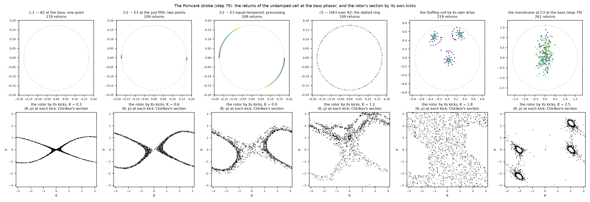
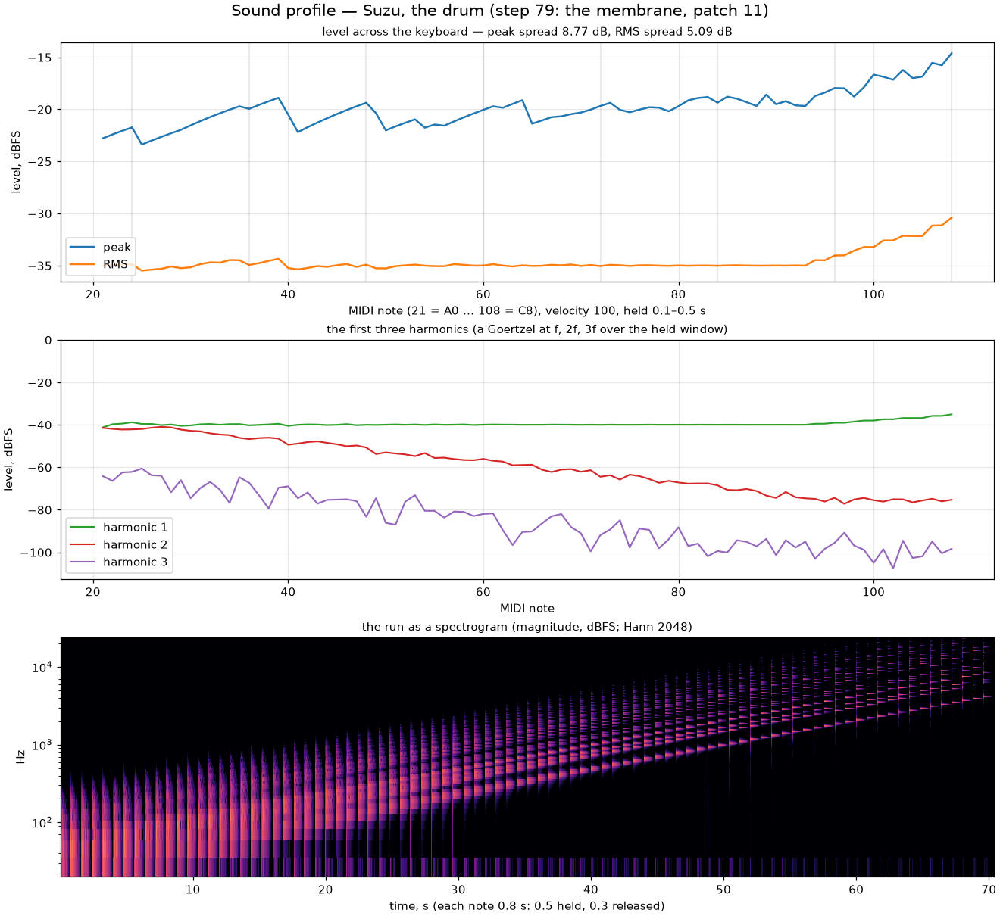
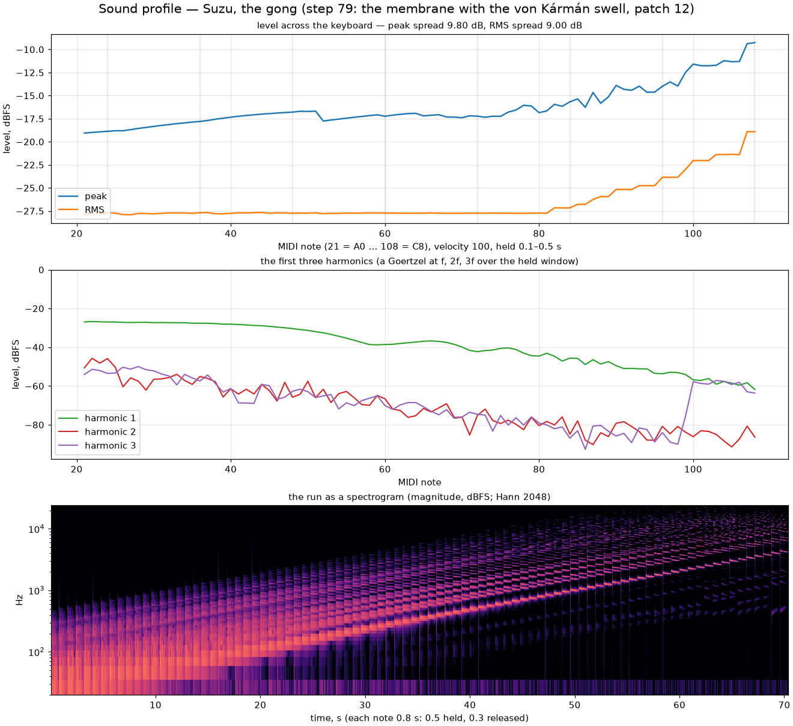

## The sheet

Where the chain gives a string's body, the membrane gives a drum's: an
$n_x \times n_y$ grid of displacements $u$ and momenta $p$ inside a ring of
zeros, with

$$
H_0 = \sum \tfrac12 p^2 + \tfrac12 c^2 |\nabla_h u|^2 + \tfrac12 \kappa^2 (\Delta_h u)^2
$$

— $c$ the tension's wave speed, $\kappa$ the plate's biharmonic stiffness,
all in grid units ($h = \Delta t = 1$ at the 2× section's rate). The step is
the leapfrog's kick, every force read from the pre-update positions —
$p \mathrel{+}= c^2 \Delta_h u - \kappa^2 \Delta_h^2 u$ — then the declared
contraction, then the drift $u \mathrel{+}= p$. The kick-then-drift map has
$\det J = 1$ exactly, and for the linear sheet it conserves a quadratic
form to the last bit of rounding: the undamped grid run for ten minutes at
96 kHz drifts by a few ten-thousandths of a decibel.

**The boundary is declared: simply supported.** The ring holds $u = 0$ and
$\Delta_h u = 0$, so the biharmonic is the five-point Laplacian applied
twice through the same zero ring, and the mode table is closed-form:

$$
\lambda_{mn} = 4\sin^2\!\frac{m\pi}{2(n_x+1)} + 4\sin^2\!\frac{n\pi}{2(n_y+1)},
\qquad \omega_{mn}^2 = c^2 \lambda_{mn} + \kappa^2 \lambda_{mn}^2 .
$$

A clamped edge would put the partials elsewhere; the suite measures the
(1,1), (2,1) and (1,2) peaks against this table within a cent, for the
membrane and for the plate. The grid is a rectangle — the rows are 13/16 of
the columns — so the degenerate pairs split and the spectrum reads as a
drum's rather than a square's.

## Pitch, stiffness, and the cut

The note is the (1,1) mode, placed through $c^2$ — continuous, so a glide
retunes the sheet per sample as the chain does. *Suzu drum stiffness* is the
biharmonic **share** of that mode's stiffness: at 0 the sheet is a membrane
whose partials go as $\sqrt{\lambda}$ (the drum's compressed inharmonic
series), at 1 a plate whose partials go as $\lambda$ (the wide spread of a
struck plate), and the note stays on the (1,1) at any share. The grid is
**cut per note**: the leapfrog's bound is $\varepsilon < 2$ on the top mode,

$$
\lambda_{2D} = \sqrt{8(c^2 + \alpha E) + 64\kappa^2} \le 1.95,
$$

with the continuum's 8 and 64 (the grid's own $\lambda_{\max}$ is a hair
under, the safe side), and since $\lambda_{2D}$ is $\varepsilon_{11}$ times
a factor of the grid, the share and the swell alone, a high note takes the
largest grid under the bar — sixteen columns to about C7, eight at C8 — and
on the two-by-two grid past it the pitch saturates, as the chain's does at
its bound. The strike is a raised-cosine bump of momentum at the *pluck
position* on both axes, scaled by $\varepsilon_{11}$ so the pickup's
displacement reads the *level* across the keyboard; the *pickup* reads the
sheet at its position, mirrored.

**The damping is the lattice's law on a grid.** $p \leftarrow (\gamma_0 +
\gamma_2 \Delta_h)\, p$ contracts the mode at $\lambda$ by $\gamma_0 -
\gamma_2 \lambda$: *Suzu decay (s)* is the fundamental's T60, *decay
brightness* the extra rate per $(\lambda/\lambda_{11} - 1)$ — the air's and
the thermoelastic loss, declared, the brighter modes dying first. The
factor acts on the momentum, whose rate is twice the amplitude's, and the
suite reads the declared T60 back within a percent.

## The gong

The tam-tam's pitch swell and its cascade on a hard strike come from the
Berger / von Kármán stretching: the sheet's mean squared gradient
$E = \sum |\nabla_h u|^2$ — one scalar read off the Laplacian pass, since
$E = -\sum u\,\Delta_h u$ — enters the Hamiltonian as $(\alpha/4)E^2$, and
the kick's $c^2$ becomes $c^2 + \alpha E$. The force depends on $u$ alone,
so the nonlinear update is still an exact momentum shear: $\det J = 1$ in
the whole phase space, one multiply-add a node. *Suzu gong swell* is $\alpha$
in the player's units: $c^2$ rises to $c^2(1 + \text{swell})$ at the cap's
stretching. The gong patch (swell 0.8) strikes C3 a hundred cents sharp at
velocity 127 and two cents sharp at velocity 30, and a second later both sit
on the note.

**The cap, and the gate at $E_{\max}$.** Because $c^2_{\text{eff}}$ rises
with amplitude, the CFL number is evaluated at the most stretching a strike
can leave: *Suzu strike cap* bounds the plain energy a strike may leave in
the sheet, in full-velocity strikes — a re-strike on a ringing drum never
exceeds it, the momentum scaled down to the remainder — and since
$H \ge \tfrac12 (c^2 + \kappa^2 \lambda_{11}) E$, the bound
$E_{\max} = 2 H_{\text{cap}} / (c^2 + \kappa^2 \lambda_{11})$ follows by
arithmetic. The load gate refuses a Courant number forced past the bar with
its sentence; with the gate bypassed the harness blows up within a second
and the bus breaker cuts the block. The class's own red control displaces a
sheet tuned to the bar to 1.2 times the cap's stretching, with the top mode
seeded: it diverges within a hundred steps.

One finding is the gong's own bar. A pure membrane at swell 1, displaced to
exactly $E_{\max}$ at $\lambda_{2D} = 1.95$ with the top mode seeded,
diverged — the (1,1)'s stretching modulates the top mode's stiffness by the
whole swell at twice its own rate, and that close to the edge the modulation
is not adiabatic — and held at 1.90 for swells up to 2. The gong's bar is
1.80; a biharmonic share lowers the modulation's depth further, and the real
strikes of the gong patch held at every note.

## The bus plate: the canvas as a soundboard

The second topology is one membrane on the **bus**, at the output rate,
stepped once a sample whatever the voices are doing: every Suzu voice feeds
its own sample into the plate at **its point** — on a play surface the
layout cell's centre, set before the note-on reaches the engine
(`voxo_set_strike_point`); from a wire or the desktop's keyboard a default
map, the note along the plate's length and a golden-ratio scatter across
it, so neighbours share no null — and the plate's two pickups, mirrored,
join the stereo sum before the reverb. It rings on after the notes end by
its own declared contraction, and under Kessho its strikes are seen where
they are heard.

The biharmonic bound scales as $h^2$, so the plate is near-membrane: at
64 × 64 and 110 Hz the declared share 0.003 sits at $\lambda_{2D}$ 1.48, and
a share asked past the gate is **clamped, not refused** — the plate is a bus
element — with a log line that says what it took. The tablets take the
mobile tier, 32 × 32, where the same tuning reads 0.46. The *Harp on a
soundboard* patch is the concert harp over the plate: under a C3–G3–E4
chord the plate's signal sits nine decibels under the dry strings, and with
the plate off the render is the concert harp's bit for bit.

## What it costs

Sixteen membranes at 16 × 13 cost a sixth of the callback on the Release
build (16.5 %, four lanes a row on NEON; the bar is 30 %); the 64 × 64 plate
under one voice the same again (16.3 %); the mobile tier's 32 × 32 a
twenty-second. The storm — fifteen channels of the drum, of the gong and of
the harp on the soundboard for twenty seconds from the Release build —
reads 0 XRuns with the render under 0.8 ms of the 2.667 ms period.

## The strobe

The membrane traces its pickup against its scaled derivative, with the
stretching and the effective $c^2$ as its aux pair; under the
[Poincaré strobe](../orbit-trace/) at the bass its returns scatter, as an
inharmonic spectrum's must — the chart's last panel.

## The profiles

The drum patch: a 16 × 13 membrane, share 0.02, the fundamental's T60 1.2 s
and the brighter modes faster. The level across the keyboard holds within
nine decibels of peak (the grids shrink above C7, and a smaller sheet
rings a little louder at the pickup); the harmonics' rows are the
inharmonic partials nearest the multiples.

The gong patch: share 0.08, swell 0.8 at a cap of one and a half strikes,
the fundamental's T60 six seconds. The spectrogram shows the swell — every
strike's partials start high and glide down onto their places as the
stretching decays.
