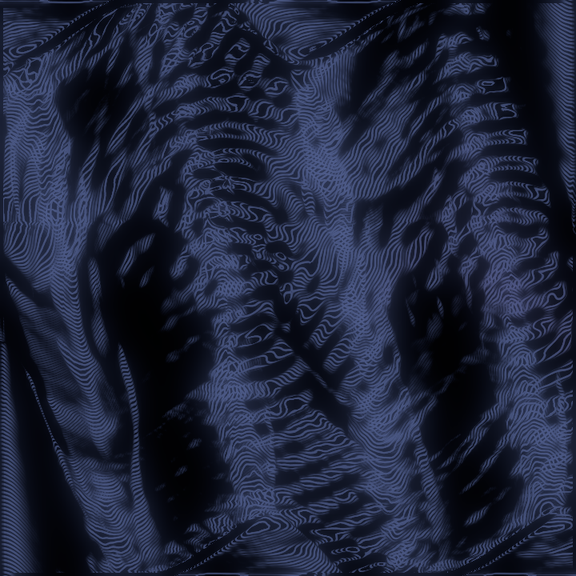

Every Suzu voice is a state moving in a plane: a cell's $(x, y)$, a
lattice's sum, the rotor's momentum on its torus, and for the strings and
the winds — whose state is a whole chain — the sound against its own slope,
the phase plane of the note. The orbit trace makes that motion visible, two
ways, from the actual trajectory and nothing else.

## The ink route (the one that marbles)

Each video frame, the shell asks the synth for what each traced voice has
drawn since the last frame — the last few milliseconds of orbit, decimated
to a handful of segments by curvature, so the bends get the vertices and a
straight run gets few — and lays it into the water at the note's cell as
[tine](../../operators/tine/) segments (or [wake](../../operators/wake/)
segments, the stylus doublet), scaled by the orbit's amplitude — under
Anod, where only charge glows, as charge specks laid along the orbit
instead, a couple of dozen a second. A pure
sine stirs a small circle. A shear-distorted orbit combs its harmonics
into the ink. The kicked rotor past its threshold scribbles. The segments
are budgeted like any feed — twenty-four a frame over all voices, the
overflow merged within each voice, never one voice dropped while another
draws — and with the trace off the water is bit-identical to a world where
the trace never existed. The route is the gesture ABI, so a
[replay](../../guide/replay/) carries the segments as it carries a pen
stroke, and the live trace stays out while a recording plays.

*The kicked rotor, four voices held in [Anod](../../operators/anod/) while
the wheel sweeps K to 2.5: its orbits inked as tines at their cells — the
synth drawing its own phase portrait.*

## The scope (the cheap sibling)

The same orbits drawn live, at their cells: on a miniature of the canvas in
the desktop's Sound section, held voices bright and released ones dim; and
on the canvas itself, screen-locked in amber over the water — or alone on
the scope's dark glass with the water hidden, the synth's phase portraits
and nothing else, while the water underneath keeps marbling. It is a
live-composite pass, the one core touch of the phase: non-destructive, and
nothing the dip, the print or the export sees.

## The Poincaré strobe (v3.0)

The trace's second mode reads the same motion the way Poincaré did: not the
whole orbit but where it is at one instant of every cycle of a reference
clock — the *stroboscopic surface of section*. The synth keeps a clean
reference phasor at the bass note's frequency, bend included (not a
zero-crossing detector on the sound, which is ill-defined for a string or a
bore), and at each of its wraps every traced voice's state is a **return**,
interpolated between the two sub-steps the wrap falls between. On the
scopes each return is a dust point; on the ink route it stamps a micro-drop
under [Sumi](../../operators/drop/), a charge speck under
[Anod](../../operators/anod/) and a micro-swirl under
[Kessho](../../operators/kessho/) at the voice's cell, through the gesture
ABI as the segments go, under the same budget.

What the dust says is the interval. A voice at the bass returns to one
point and stays there. A voice a just fifth above (3:2) alternates between
two antipodal points. The equal-tempered fifth, 1.955 cents short of just,
shows its two points slowly precessing — a little over a radian a second at
A2, the temperament made visible. A tritone, $\sqrt 2$ over the bass and
incommensurate, lays a dotted ring. The kicked rotor past its threshold
scatters dust. A third choice strobes a voice with a drive of its own by
that drive — the Duffing cell at its drive's phase wrap, the kicked rotor
at each kick, where its returns $(\theta, p)$ are exactly Chirikov's
section, the one the [lab's chaos page](../lab/) draws — and the other
kinds keep the bass. The strobe only reads: the sound is bit-identical with
it on or off, and the audio thread allocates nothing for it.

*The undamped cell strobed at the bass — one point, two points, the
precessing pair, the dotted ring — and the rotor strobed by its own kicks
for K from 0.3 to 2.5: a closed curve, then dust.*

## The knobs

In the desktop's *Suzu trace* section, the settings file and the preset: a
switch for each route (*ink*, *scope*), *this voice kind* (per kind — the
rotor traces by default), the *scale* in canvas heights per unit amplitude
(a cell's amplitude is the level: 0.25 at velocity 127), four to eight
*segments* a voice a frame, the *stroke* (tine, exact; wake, sub-stepped),
*on the canvas*: off, over the water, or the scope alone — and the *mode*:
continuous (the segments), the Poincaré strobe on the bass phasor, or the
strobe on each voice's own drive clock.

**On the tablets** the Sound page carries the two routes under *Synth
trace* whenever the synth is the source: *Draw the orbits into the water*
(off by default — on, every synth note stirs the water at its cell) and
*Scope on the canvas* (off, over the water, alone), with *Trace scale* —
the desktop's knob: 0.25 draws the rotor well, the modal voices and the
winds, whose orbits are smaller, want more. Every voice kind is traced
there; the patch picks what sounds. The bridge is the same code on
the three shells, a library beside the presets and the replay, and a
tablet's recording carries its ink segments as the desktop's does.

The [Suzu lab](../lab/) draws these portraits as well, from the same ring
read at full density, one point every sub-step.
