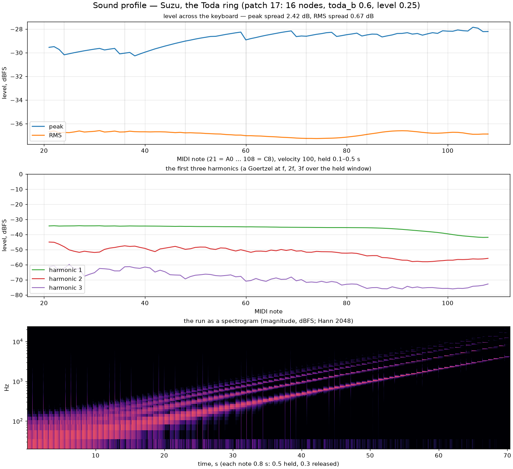

import Lab from "../../../components/Lab.astro";

## The ring

Take $N$ equal masses on a closed ring, and join each to the next by a spring
whose force is not linear but exponential in the compression:

$$
H = \sum_n \frac{p_n^2}{2} + \frac{a}{b} \sum_n \left( e^{-b\,r_n} + b\,r_n - 1 \right),
\qquad r_n = q_{n+1} - q_n .
$$

That is the Toda lattice, and it is the one nonlinear chain that is exactly
integrable: pulses on it travel as *solitons* — localised compressions that
keep their shape, outrun the sound speed, and pass through each other with
nothing but a phase shift. Near $r = 0$ the spring is linear with stiffness
$k = a\,b$; compressed, it stiffens as $e^{b\,|r|}$; stretched, it goes slack.
The parameter $b$ is the whole character of the voice. At $b \to 0$ the ring
is a plain mass–spring loop, and its modes are the lattice's,

$$
\frac{\omega_m}{\omega_1} = \frac{\sin(m\pi/N)}{\sin(\pi/N)}, \qquad m = 1 \dots N/2,
$$

an inharmonic series that flattens toward the top — a marimba bar's kind of
spectrum, with the fundamental set on the note exactly (the engine solves
$2\sqrt{k}\,\sin(\pi/N) = 2\sin(\omega h/2)$, the leapfrog's own frequency,
so the suite reads mode 1 on A3 within a hundredth of a cent and modes 2–5
on their ratios within a hundredth of a percent). At large $b$ the strike's
pulse self-focuses: the exact Toda soliton is

$$
e^{-b\,r_n} - 1 = \sinh^2\!\kappa \; \operatorname{sech}^2\!\left(\kappa n - t \sinh\kappa\right),
$$

its amplitude fixing its width $1/\kappa$ and its speed $\sinh\kappa/\kappa$
times the sound speed. The ring does not tune a soliton's pitch; the pulse
train's rate at the pickup is the soliton's lap time, and it rises with the
press — at A3 under full press the fundamental sits 427 cents above the
note, with the fifth harmonic eleven decibels under it: a clavinet's pulse,
from the same strike that a light press rings like a bar.

The press and CC 74 above centre set the nonlinearity,
$b = \mathit{toda\_b} \cdot 4 \cdot (0.05 + 0.95\,\mathrm{clamp}(\text{press} + 2(\text{CC\,74} - \tfrac12)))$,
so the voice goes from the linear ring to the train under the finger. The
strike is a Gaussian compression of *toda_width* nodes at the cell's
position, mean-free around the ring (its length is fixed), launched to the
right with $p = -\sqrt{k}\,r$ — exact for the linear wave; the soliton
outruns it and the rest radiates. Its amplitude is the level times the
velocity, in strain units, and the output divides the same back: *the level
is the strike's strength* — a louder patch presses the ring harder and gets
more soliton, as the Duffing cell and the membrane do.

## The step, in double

The ring is advanced by the kick-then-drift leapfrog — the momenta take the
force from the present positions, then the positions take the momenta —
twice a sub-step at the ×4 rate of step 78, each reading through the first
half-band stage, the second stage down to the output rate. Its state is
double, alone among Suzu's voices: the gate below asks a thousandth of a
decibel over ten minutes, and in float the rounding of $q \mathrel{+}= p$
at 192 kHz walked the energy a hundredth of a decibel a minute. Sixteen to
sixty-four nodes pay for it easily — a voice costs about 1 % of a core at A2.
The exponential is the ring's own: a range reduction and a degree-eleven
polynomial, exact to double's precision, plain arithmetic the compiler
spreads across the nodes and the same bits on every platform — the C
library's `exp` was a whole tablet's budget.

The leapfrog conserves a *modified* Hamiltonian, not $H$ and not the Toda
lattice's Lax invariants: the discrete ring is near-integrable. That is
what the gates measure. Ten minutes of 192 kHz steps, lossless, at full
nonlinearity: the mean of $H$ over each minute drifts 0.000017 dB from the
first minute, while $H$ itself breathes ±0.06 dB under it with no trend;
the biggest soliton — the struck pulse of 0.76 self-focused to 0.97, $\kappa$
1.83, a width of half a node — holds its amplitude within 0.26 % and its
amplitude × profile width within 0.72 %; $\Sigma p$ stays at $10^{-14}$.
The roadmap's 2 % and 0.001 dB are met with room.

## The resolution rule

A fortissimo C7 found the ring's real bound. The membrane's kind of bound —
the local stiffness under the leapfrog's $\omega h < 2$ — was in place and
the ring blew up anyway. On the ring alone the cause measured cleanly: the
leapfrog resolves the exponential along the trajectory only while a step's
displacement over the exponential's length,

$$
s = \sqrt{k} \cdot \hat c \cdot b \qquad (\hat c \text{ the compression's peak}),
$$

stays small — past about 0.5 uncapped, and past 0.22 with the cap engaged,
the integrator makes energy by the tens of decibels a second, whatever the
cap's shape. So the ring's rate follows the pulse: two, four, six or eight
inner steps a sub-step, chosen every block from the present peak and $b$ to
hold $s$ under 0.15 ($\sqrt{k}$ falls as $1/m$; a change rescales the momenta
exactly and the pickup is still read twice a sub-step). Where eight cannot
reach it — a hard strike at the top of the keyboard — the nonlinearity is
*capped for the note* at the strike, with an allowance of 1.3× for the
self-focusing, and the ceiling is lowered if the pulse outgrows it, never
raised. The first version of that limiter followed the live peak block by
block and *pumped* the pulse: re-shaping the potential under a soliton puts
energy into it. A ceiling fixed at the strike does not.

The exponential's ceiling is soft: $E = e^{-br}$ up to half the cap and
$\mathrm{cap} - \mathrm{cap}^2/4e$ past it, continuous in slope — a plain
`min()` left a kink the leapfrog fed on at the margin — and the cap is
held under $k \cdot \mathrm{cap} \le 0.9$ at the note. *Toda gate* off is the
red control: the ring as written, two inner steps, the cap and $b$ as
asked. The suite strikes C8 at level 1, velocity 127, full press, lossless:
under the rule eight inner steps, $b$ 0.46 of the 2.40 asked, +0.9 dB over
the second, the output under 0 dBFS; with the gate off +19 dB in the
second. The inspection reports what the rule did — the inner steps, the $b$
asked, the ceiling, the $b$ applied.

## The swirl, and where the pickup stands

Poly pressure is not a parameter of the ring but a push on all of it: a
uniform momentum $J \cdot \Delta\text{swirl} \cdot \sqrt{k}$ a node, a
quarter of the sound speed at full pressure, on note-on and on every change
of the value, and nothing while it is held. The symmetric force conserves
$\Sigma p$ exactly, so the ring drifts at that speed for as long as the
decay lets it. A pickup fixed to a node would hear none of it — a Galilean
boost leaves every bond's compression as it was. So the pickup *stands in
the lab*: its lattice coordinate runs back at $\Sigma p / N$ a step, and it
reads the compression there through a cubic over the four nearest bonds.
The solitons ride the boost past it, and the train's rate rises by the
Galilean $(c + v)/c$ — +19.7 % at full pressure, in the suite.

A fully Eulerian pickup — the point in the lab that solves
$\xi + q(\xi) = x$ each step — was tried first, and it hears the physics of a
point probe: a hard soliton brings neighbouring masses to a twenty-fifth of
their spacing, and the density spike it reads put −43 dB of content in the
top octave. The lattice reading keeps the half-bands' floor, −132 dB.

## What it costs

A voice at A2 with sixteen nodes is 1.1 % of a core, 3.0 % with sixty-four;
at C7 the rule's inner steps make it 1.7 % (sixteen) and 9 % (sixty-four:
an exponential per node per inner step). Sixteen rings from C3 to C7 at
full press take 18.6 % of the period on the Release build (the bar 30 %). The tablets cap the
inner steps at four and the nodes at thirty-two, and the note's ceiling on
the nonlinearity takes what four cannot — the top notes a little tamer
there. The iPad plays the patch under the spike with headroom to spare;
the Galaxy Tab's audio thread, which runs every voice some forty times
slower than a Mac core, is over its burst with this one as with the
membrane — a scheduling matter for that shell, not the ring's.

<Lab page="toda" caption="The Toda ring, live: the nodes drawn out by their bond's compression, the strobe's returns, the ledger H on the strip, and the resolution rule's readouts — the inner steps, the b asked, applied and capped. Press hard and strike: the train of solitons sharp of the note. The red control switches the gate off." />

## The strobe

Under the [Poincaré strobe](../orbit-trace/) at the bass — its own note —
the ring returns once a period, 440 of 440 over two seconds at A3 under
full press, and the points walk the section: the train outruns the note, so
each return catches the pulse elsewhere on its lap. The trace's aux pair is
the biggest soliton and the drift.

## The profile

The *Toda ring* patch is the eighteenth of the [table](../patches/); the
desktop's Sound section carries the nodes, the nonlinearity, the cap and
the pulse width; a preset file carries the same four fields (schema 2, a
file from before leaving them at the defaults).
